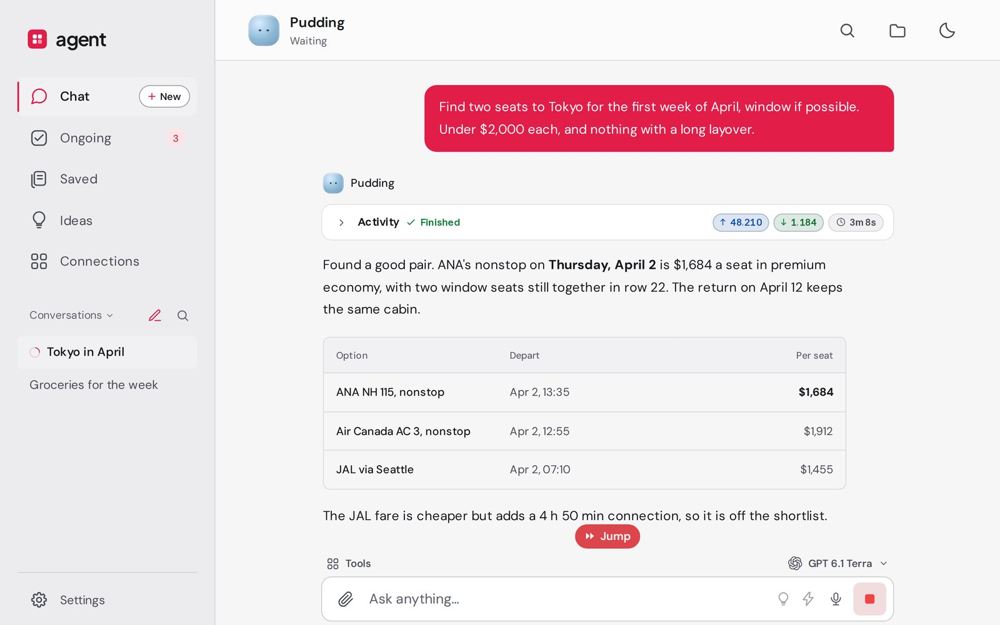
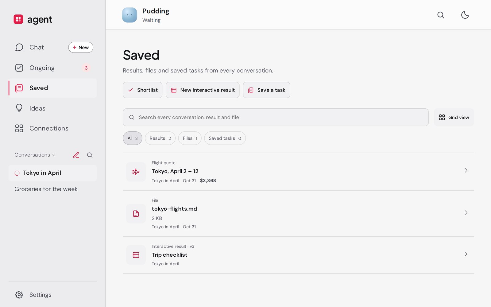
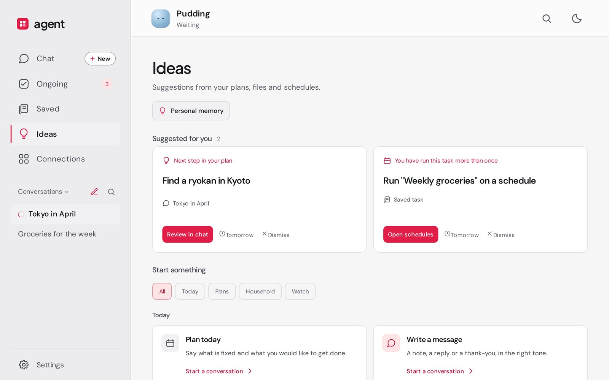
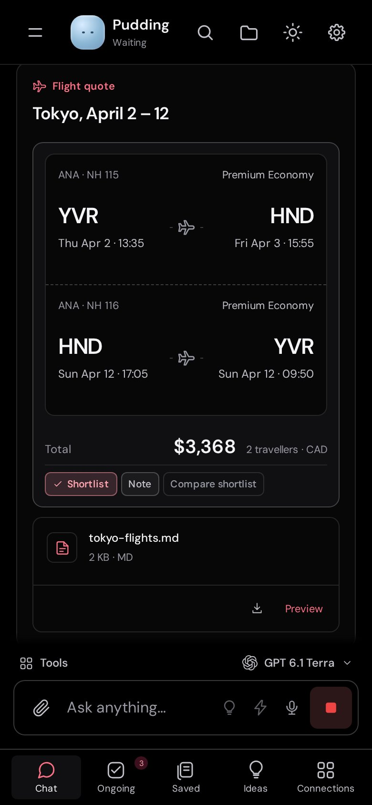
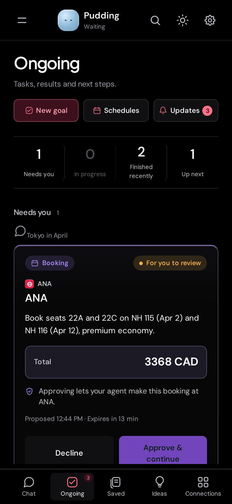
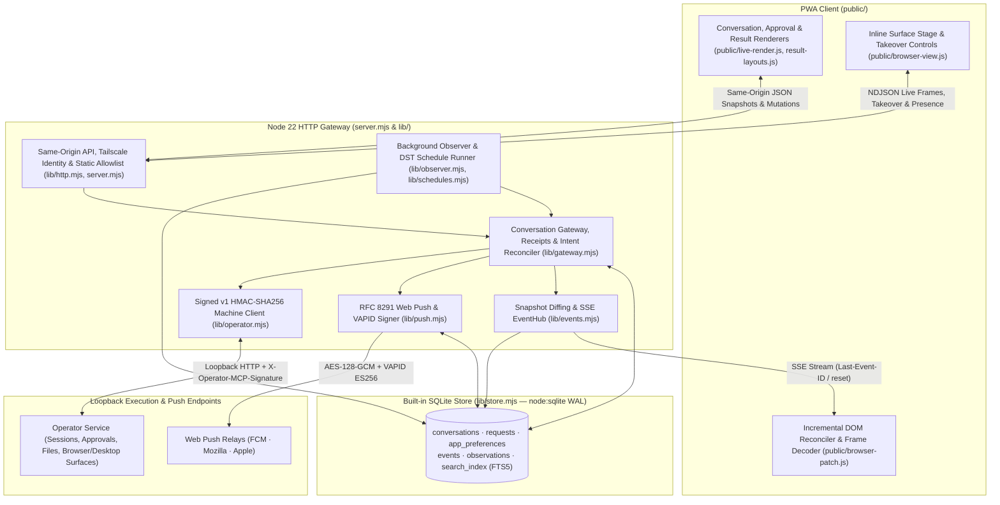

# agent

A conversation-first web and phone app for a personal agent: ask for something, check what is running or waiting on a decision, and open the finished result without managing models, tools or sessions.

[](public/)
[](lib/)
[](lib/store.mjs)



`agent` puts a consumer-facing Progressive Web App in front of the [Operator](https://github.com/jeffbai996/operator) execution service. A zero-dependency Node 22 gateway owns conversation links, idempotent delivery receipts, an ordered event log, a full-text search index, and recurring schedules in built-in SQLite (`node:sqlite`), while delegating live runs, browser tabs, and sandboxed desktops to Operator over a signed loopback API. Most of the work went into keeping state honest across reloads, restarts, and second devices: every status comes from recorded events rather than model prose, an interrupted send becomes `unknown` and is never replayed, and approvals bind to a SHA-256 proposal fingerprint so an expired, edited, or superseded action cannot execute.

## Highlights

- Every message send, saved-task run, and approval continuation records a client request ID in SQLite (`requests`) as `sending` before upstream dispatch. On gateway startup, any row left in `sending` transitions to `unknown` (`delivery.unknown`) and is never replayed, so a restart mid-request cannot duplicate an order or message.
- Approval cards bind `Approve & continue` and `Decline` to the upstream proposal's 64-character SHA-256 `fingerprint` and 15-minute expiry window, separating the recorded decision (`approved`) from execution progress and the verified external outcome (`confirmed`).
- Background changes are derived by diffing consecutive snapshots into an owner-scoped SQLite `events` log with deterministic keys (`conversation:kind:identifier`). Clients follow a resumable Server-Sent Events stream (`Last-Event-ID`) that emits `reset` when a cursor falls behind the 2,000-event retention window, while a server-side observer polls active runs so completions and pending approvals are recorded with no browser tab open.
- Live conversation updates reconcile into the DOM (`replaceConversationContent` and `patchBrowserCard`) by memoizing per-message render signatures in a `WeakMap`, pre-decoding incoming base64 JPEG viewport frames with `HTMLImageElement.decode()` before swapping nodes, and preserving focused inputs, open `<details>` timelines, and scroll anchoring.
- Recurring reminders and tasks (`lib/schedules.mjs`) solve local wall-clock occurrences across daylight-saving transitions with a 3-iteration `Intl.DateTimeFormat.formatToParts` offset loop, skip tasks more than 10 minutes late (`LATE = 600000`) instead of running stale work, enforce a 15-minute per-run budget, and dispatch each occurrence into a fresh conversation so prior approvals never carry over.
- Web Push notifications (`lib/push.mjs`) implement RFC 8291 / RFC 8188 `aes128gcm` payload encryption (`prime256v1` ECDH key agreement and HKDF-SHA256 key/nonce derivation) and ES256 VAPID JWT signing directly on `node:crypto` with no external packages.

## Screenshots

The view above is one finished turn: the request, the agent's activity with its token counts and duration, and a reply that compares three fares. Below the reply, the result renders as a flight quote with each leg, cabin, and the total for both travellers, with shortlist, note, and compare actions. Booking it becomes an approval card with the merchant, total, 15-minute expiry, and the plain-language consequence of approving; the run does not continue until `Approve & continue` is pressed.

| Saved results and full-text search | Source-linked Ideas |
| :---: | :---: |
|  |  |
| Interactive results, generated files, and reusable saved tasks across every conversation, backed by an SQLite FTS5 index (`search_index`) with prefix matching and snippet extraction. | Suggestions derived from recorded work: the next unfinished checkpoint in a plan, a saved task run more than once by hand, or a missed schedule, each requiring explicit acceptance before starting a run. |

<table>
  <tr>
    <td width="50%" valign="top"></td>
    <td width="50%" valign="top"></td>
  </tr>
</table>

Phone layout on a 390 px viewport in the OLED theme: the flight quote from the same conversation (left), and the Ongoing decision queue with the booking waiting on approval (right).

## Architecture



`agent` separates client presentation, gateway state and event derivation, local SQLite persistence, and upstream execution into four layers. The HTTP entry point (`server.mjs` and `lib/http.mjs`) binds to loopback in live mode, authenticates callers from the Tailscale identity header (`Tailscale-User-Login`) hashed with SHA-256 into an owner key, enforces `Origin` and `Sec-Fetch-Site` checks on mutations, and serves a fixed static asset allowlist under a strict Content Security Policy. `Gateway` (`lib/gateway.mjs`) serializes per-conversation mutations, merges upstream agent state, workspace jobs, and turn history into cached snapshots, budgets user-edited saved results into new prompts (`savedResultsContext`), and reconciles recorded `stop` and `takeover` intents against the active run's `started_ts` and `run_id`. Every snapshot diff passes through `deriveEvents` (`lib/events.mjs`) into `Store` (`lib/store.mjs`), which persists idempotent event rows, updates the FTS5 `search_index`, fans new events out to open Server-Sent Events connections (`EventHub`), and triggers `Push` (`lib/push.mjs`) for lock-screen notifications. In the background, `Observer` (`lib/observer.mjs`) and `Schedules` (`lib/schedules.mjs`) tick every 15 seconds so in-flight runs and due schedules advance whether or not a client device is connected.

## Inside this repository

| Module | Lines | Responsibility |
| :--- | ---: | :--- |
| [`public/live-render.js`](public/live-render.js) | 1,084 | Client renderer for live conversation turns, fingerprinted approval cards (`purchase`, `booking`, `message`, `windows_admin`, `host_session`), itemized receipt breakdowns, checkout-stop upgrades, verified result cards, and coalesced activity timelines. |
| [`lib/gateway.mjs`](lib/gateway.mjs) | 929 | Conversation gateway managing owner isolation, per-conversation async locks, at-most-once delivery receipts, restart recovery (`delivery.unknown`), saved-result prompt budgeting (`savedResultsContext`), `stop` / `takeover` intent reconciliation, and fingerprint-bound approval continuations. |
| [`public/browser-view.js`](public/browser-view.js) | 497 | Inline and expanded stage card for `Operator Browser`, `Operator Linux` (sandboxed XFCE desktop), and `Operator Desktop` (host PC), with automatic surface detection, tab/window pickers, takeover keyboard/URL bars, and docked step inspectors. |
| [`public/browser-patch.js`](public/browser-patch.js) | 428 | Incremental DOM reconciliation (`replaceConversationContent`, `patchBrowserCard`) with `WeakMap` message signature caching, off-screen `HTMLImageElement.decode()` frame swapping, normalized letterbox coordinate mapping (`browserImagePoint`), and `ResizeObserver` scroll pinning. |
| [`lib/store.mjs`](lib/store.mjs) | 344 | Zero-dependency persistence layer built on Node 22 `node:sqlite` (`DatabaseSync`) in WAL mode, managing `conversations`, `requests` (with startup `sending -> unknown` recovery), versioned `app_preferences`, cursor-ordered `events`, `observations`, and the FTS5 `search_index`. |
| [`lib/schedules.mjs`](lib/schedules.mjs) | 327 | App-owned recurring schedule engine supporting daily, weekday, and weekly cadences across time zones (`nextOccurrence`), a 10-minute missed-run skip window, a 15-minute per-run execution cap, and fresh-conversation dispatch. |
| [`lib/operator.mjs`](lib/operator.mjs) | 304 | Loopback client for Operator's machine API implementing canonical `v1` HMAC-SHA256 request signing (`sign`), sorted RFC 3986 query normalization, 35-second `AbortSignal` timeouts, and session/workspace/approval/takeover/live-frame methods. |
| [`lib/push.mjs`](lib/push.mjs) | 233 | Pure `node:crypto` Web Push implementation: endpoint allowlist and P-256 public key validation (`validateSubscription`), RFC 8291 / RFC 8188 `aes128gcm` encryption (`encryptPush`), ES256 VAPID JWT generation, and per-device delivery state with `404`/`410` auto-unsubscription. |
| [`public/result-layouts.js`](public/result-layouts.js) | 144 | Structured result layouts for product, place, and home comparison shortlists, multi-segment flight itineraries (including automatic Markdown table promotion), hotel stays, and live delivery order progress tracks with ETA extraction. |
| [`lib/events.mjs`](lib/events.mjs) | 116 | Snapshot-to-event derivation (`deriveEvents`) for replies, results, files, approval transitions, run endings, and handoffs, FTS5 document extraction (`indexEntries`), and the SSE `EventHub` with per-owner connection caps (`perOwner = 8`). |

This repository holds selected modules from a private codebase and is not runnable on its own.

## How it works

### 1. Fingerprint-bound approval continuation and at-most-once receipts (`lib/gateway.mjs`)

Every state-changing dispatch is recorded in SQLite with `state = 'sending'` before the gateway calls Operator, and any request still in `sending` when the process starts is moved to `unknown` (`lib/store.mjs`) and never resent. Approvals apply the same invariant to continuations: `Gateway.decision` checks that the upstream proposal is still `pending` (or already settled to the same decision) and that its 64-character SHA-256 `fingerprint` matches what the user reviewed. It then derives a deterministic continuation receipt ID (`approval-<sha256>`) and only increments the attempt counter if a prior continuation definitively `failed`, so retrying on a second device or after an uncertain network drop returns the existing receipt instead of dispatching a second run:

```javascript
const key = createHash("sha256")
  .update(JSON.stringify([id, approvalId, fingerprint]))
  .digest("hex");
let attempt =
  this.store.preference(owner, "approval-attempt", key).attempt || 0;
const receiptId = (n) =>
  "approval-" + createHash("sha256").update(key + ":" + n).digest("hex");
// Only a definite rejection can get a fresh attempt on an explicit retry.
// Uncertain delivery and accepted receipts retain their original identity.
if (this.store.request(receiptId(attempt))?.state === "failed") {
  attempt++;
  this.store.prefer(owner, "approval-attempt", key, { attempt });
}
return this.deliver(
  owner, id, receiptId(attempt),
  "Continue with the approved action " + approvalId +
    ". Recheck its exact details before committing. If already submitted, verify the outcome instead of repeating it.",
  row,
);
```

### 2. DST-safe wall-clock recurrence without a date library (`lib/schedules.mjs`)

Recurring tasks are stored as local wall-clock specifications (`every: "day" | "weekday" | "week"` plus `HH:MM` and an IANA `timeZone`) rather than fixed millisecond intervals, so a 09:00 schedule stays at 09:00 local time across daylight-saving transitions. `nextOccurrence` avoids external calendar packages by extracting local date/time fields via `Intl.DateTimeFormat("en-US", { timeZone, hourCycle: "h23", ... }).formatToParts` and running a 3-step offset correction loop around `Date.UTC` for each candidate calendar day:

```javascript
export function nextOccurrence(after, repeat, timeZone) {
  const [h, m] = repeat.time.split(":").map(Number);
  const instant = (y, mo, d) => {
    const wanted = Date.UTC(y, mo - 1, d, h, m);
    let guess = wanted;
    for (let i = 0; i < 3; i++) {
      const p = parts(timeZone, guess);
      guess += wanted - Date.UTC(p.y, p.mo - 1, p.d, p.h, p.mi, p.s);
    }
    return guess;
  };
  const start = parts(timeZone, after);
  for (let i = 0; i < 400; i++) {
    const day = new Date(Date.UTC(start.y, start.mo - 1, start.d + i));
    const wd = day.getUTCDay();
    if (repeat.every === "weekday" && (wd === 0 || wd === 6)) continue;
    if (repeat.every === "week" && wd !== repeat.weekday) continue;
    const t = instant(day.getUTCFullYear(), day.getUTCMonth() + 1, day.getUTCDate());
    if (t > after) return t;
  }
  throw failure("Choose a valid repeat.");
}
```

### 3. Flicker-free viewport frame swapping and DOM reconciliation (`public/browser-patch.js`)

While a run is active, the client receives both conversation snapshots and live base64 JPEG frames from the active browser or desktop surface. Replacing `innerHTML` on the conversation container would collapse open `<details>` step logs, drop keyboard focus inside the takeover bar, and flash blank images while new frames decode. `replaceConversationContent` retains unchanged message nodes via a `WeakMap` signature cache and delegates the active surface card to `patchBrowserCard`, which pre-decodes each incoming data URI off-screen with `HTMLImageElement.decode()` before swapping the `` element in place:

```javascript
const curImg = existing.querySelector(".browser-frame img");
const nextImg = next.querySelector(".browser-frame img");
if (curImg && nextImg) {
  if (curImg.alt !== nextImg.alt) curImg.alt = nextImg.alt;
  const nextSrc = nextImg.getAttribute("src") || "";
  if (curImg.dataset.pendingSrc && curImg.dataset.pendingSrc !== nextSrc) delete curImg.dataset.pendingSrc;
  if (nextSrc && curImg.getAttribute("src") !== nextSrc && curImg.dataset.pendingSrc !== nextSrc) {
    curImg.dataset.pendingSrc = nextSrc;
    const pre = new Image();
    for (const attr of curImg.attributes) {
      if (attr.name !== 'src' && attr.name !== 'data-pending-src') pre.setAttribute(attr.name, attr.value);
    }
    const commit = () => {
      if (curImg.isConnected && curImg.dataset.pendingSrc === nextSrc) curImg.replaceWith(pre);
    };
    const reject = () => {
      if (curImg.dataset.pendingSrc === nextSrc) delete curImg.dataset.pendingSrc;
    };
    pre.src = nextSrc;
    if (typeof pre.decode === 'function') pre.decode().then(commit, reject);
    else { pre.onload = commit; pre.onerror = reject; }
  }
  return true;
}
```

## Stack

| Layer | Technologies |
| :--- | :--- |
| Gateway and runtime | Node.js 22 (`node:http`, `node:sqlite`, `node:crypto`, `node:stream`, native `fetch`), zero npm dependencies |
| Storage and search | SQLite in WAL mode (`DatabaseSync`), SQLite FTS5 (`search_index` with prefix matching and `snippet()`) |
| Push and machine auth | RFC 8291 / RFC 8188 Web Push (`prime256v1` ECDH, HKDF-SHA256, `aes-128-gcm`), RFC 8292 VAPID (`ES256` JWT), HMAC-SHA256 (`v1` canonical request envelopes) |
| Client and PWA | Vanilla ES2024 modules, Server-Sent Events (`Last-Event-ID`), NDJSON streaming (`ReadableStream`), CSS custom properties (Light and OLED themes), Service Worker static shell, Web App Manifest |

## License

The source is proprietary. This repository shows selected modules for reading; no license is granted to use, copy, modify or distribute them.
