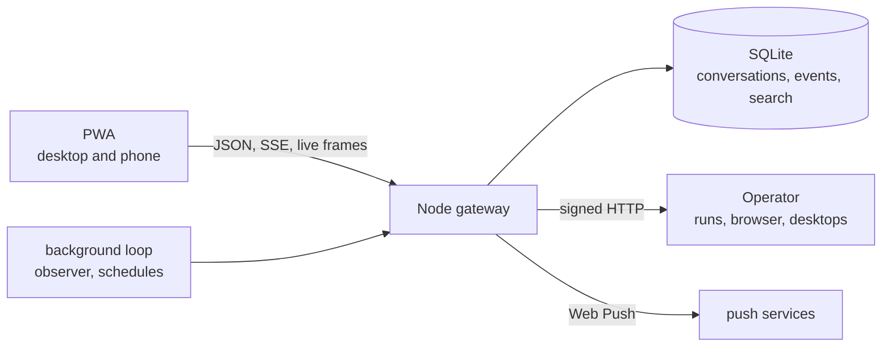

# agent

A chat app for my personal agent, on the desktop and on my phone. I ask for something, it goes off and does it, and anything that spends money or acts for me waits until I approve it.

[](public/)
[](lib/)
[](lib/store.mjs)


The agent itself runs somewhere else. [Operator](https://github.com/jeffbai996/operator) does the browsing, the tool calls and the sandboxed desktops. This app is the part I actually hold: conversations, results, notifications and schedules. Most of the effort went into making sure it never shows me something that isn't true. If it says a booking went through, there is a recorded event behind it, not just a sentence from the model.

## Screenshots

| Saved | Ideas |
| :---: | :---: |
|  |  |
| Everything the agent made, across all conversations, with full-text search. | Suggestions from recorded work, like the next step of a plan. Nothing starts until I accept it. |

<table>
  <tr>
    <td width="50%" valign="top"></td>
    <td width="50%" valign="top"></td>
  </tr>
</table>

On the phone: a request with a photo attached, and a flight booking waiting for approval.

## How it fits together



The server is plain Node 22 with no npm dependencies. Storage is `node:sqlite`, and push encryption and signing are done with `node:crypto`. The client is vanilla ES modules and a service worker, with no framework and no build step. The background loop runs on the server, so a job that finishes while every tab is closed still shows up in Ongoing and still sends a push.

## Parts worth reading

**Nothing is sent twice.** A message is written to SQLite as `sending` before it goes to Operator. If the server restarts mid-request, that row becomes `unknown` on boot and stays that way, and the app says "Delivery uncertain" instead of retrying. Retrying is how you end up with two hotel bookings.

**An approval is tied to what I saw.** Each approval card carries a fingerprint of the exact proposal. If the proposal changes or expires, the old button stops working:

```javascript
if (
  !a ||
  a.fingerprint !== fingerprint ||
  !["pending", approved ? "approved" : "declined"].includes(a.status)
)
  throw failure(
    "This approval changed or is no longer pending. Refresh to review it.",
    409,
  );
```

The continuation that follows gets a receipt ID derived from the conversation, the approval and the fingerprint. Tapping Approve again on a second device finds the same receipt instead of starting another run. Only a definite failure earns a fresh attempt ([`lib/gateway.mjs`](lib/gateway.mjs)).

**Status comes from events, not prose.** Each new snapshot from Operator is compared with the last one, and the differences go into an event log: a reply arrived, an approval is pending, a run failed. Clients follow that log over Server-Sent Events and resume from the last event they saw ([`lib/events.mjs`](lib/events.mjs)).

**Reminders keep local time.** A 9:00 reminder stays at 9:00 across daylight saving, without a date library. The schedule asks `Intl.DateTimeFormat` for the wall-clock time in the right zone and corrects the offset in a short loop. A run more than ten minutes late is skipped, not fired stale ([`lib/schedules.mjs`](lib/schedules.mjs)):

```javascript
const instant = (y, mo, d) => {
  const wanted = Date.UTC(y, mo - 1, d, h, m);
  let guess = wanted;
  for (let i = 0; i < 3; i++) {
    const p = parts(timeZone, guess);
    guess += wanted - Date.UTC(p.y, p.mo - 1, p.d, p.h, p.mi, p.s);
  }
  return guess;
};
```

**The live browser view doesn't flicker.** While a run is going, frames from the agent's browser arrive as JPEGs. Each one is decoded off-screen before it replaces the old one. Messages that haven't changed are left in place, so an open step log or a half-typed instruction survives the update ([`public/browser-patch.js`](public/browser-patch.js)).

## What's in this repository

A handful of modules from a private codebase. It won't run on its own.

| File | What it does |
| :--- | :--- |
| [`public/live-render.js`](public/live-render.js) | Draws conversations, approval cards, receipts and results |
| [`public/result-layouts.js`](public/result-layouts.js) | Layouts for flights, stays, shortlists and delivery tracking |
| [`public/browser-view.js`](public/browser-view.js) | The live browser and desktop card, with takeover controls |
| [`public/browser-patch.js`](public/browser-patch.js) | Updates the page in place so live changes don't reset it |
| [`lib/gateway.mjs`](lib/gateway.mjs) | Conversations, delivery receipts, approvals, stop and takeover |
| [`lib/events.mjs`](lib/events.mjs) | Turns snapshot changes into events, and the SSE hub |
| [`lib/store.mjs`](lib/store.mjs) | SQLite storage and full-text search |
| [`lib/schedules.mjs`](lib/schedules.mjs) | Recurring reminders and tasks |
| [`lib/push.mjs`](lib/push.mjs) | Web Push encryption and VAPID signing on `node:crypto` |
| [`lib/operator.mjs`](lib/operator.mjs) | Signed client for Operator's API |

Photos in the screenshots are public domain or CC0, from Wikimedia Commons.

## License

Proprietary. The code is here to read; no license is granted to use, copy, modify or distribute it.
